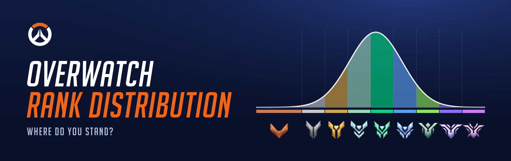
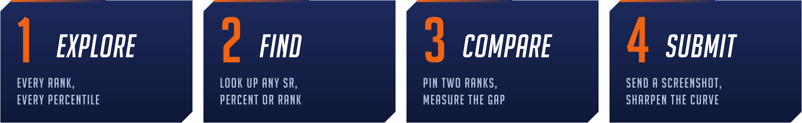
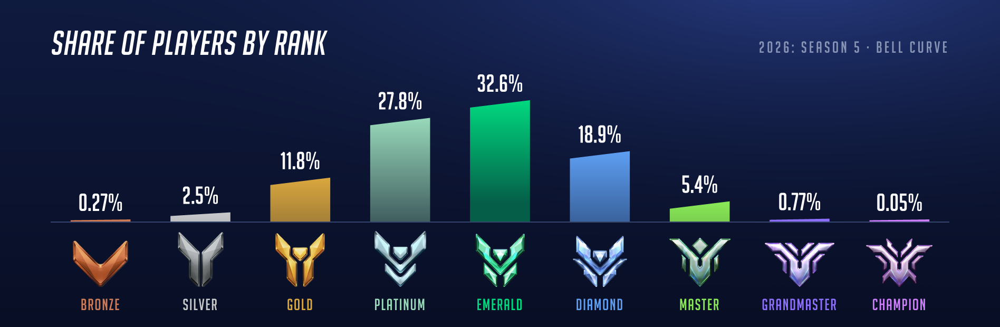
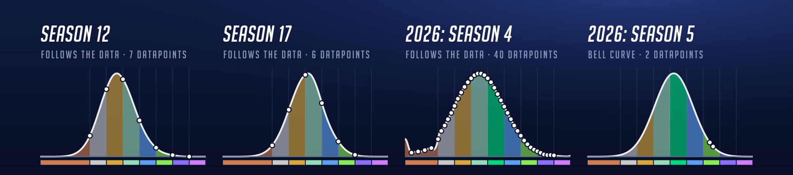

<p align="center">
  <a href="https://owengregson.github.io/OverwatchRankDistribution/">
    
  </a>
</p>

<p align="center">
  <a href="https://owengregson.github.io/OverwatchRankDistribution/"><b>PLAY IT LIVE</b></a>
  &nbsp;·&nbsp;
  <a href="https://owengregson.github.io/OverwatchRankDistribution/articles/">GUIDES</a>
  &nbsp;·&nbsp;
  <a href="#run-it">RUN IT</a>
  &nbsp;·&nbsp;
  <a href="#the-curve">THE CURVE</a>
  &nbsp;·&nbsp;
  <a href="#go-live">GO LIVE</a>
  &nbsp;·&nbsp;
  <a href="docs/DETAILS.md">DEEP DIVE</a>
</p>

See where any Overwatch rank sits among every player. Move along the curve, look a rank up, pin two to compare.

Unofficial fan project, not affiliated with Blizzard Entertainment.





<a name="run-it"></a>


```bash
npm install
```

```bash
npm run dev
```

Dev talks to the same database as the live site (`src/config.js`). Empty `anonKey` there and it keeps everything in your browser instead: admin at `/#/admin`, any email, password `admin`.

| Command | What it does |
| --- | --- |
| `npm run build` | Static site into `dist/` |
| `npm run preview` | Serve the build |
| `npm test` | Model, ladder and screenshot reader tests |
| `npm run images` | Redraw every generated image, this page's included |
| `npm run check:site` | Check the built site's links and pages |

<a name="the-curve"></a>




- **A season is a list of datapoints.** Each says: this rank (or SR) beats this share of players.
- **The curve is fitted to them, never drawn.** The white dots above are the datapoints.
- **Two fits.** `normal` is the best-fit bell curve, for a few noisy community figures. `freeform` passes through every point, for a season whose whole distribution was published.

Seasons live in `src/data/seasons/*.json`:

```json
{
  "id": "2026-season-5",
  "year": 2026,
  "number": 5,
  "name": "2026: Season 5",
  "model": "normal",
  "datapoints": [
    { "rank": "Master 3", "betterThan": 97, "role": "tank" },
    { "sr": 3800, "betterThan": 98, "role": "support", "weight": 2, "note": "optional" }
  ]
}
```

`role` is the role the figure is for: `tank`, `damage` or `support`. It is kept with the datapoint and does not change the curve.

| Optional field | Effect |
| --- | --- |
| `"ladder": "classic"` | Played on the ladder before Emerald existed |
| `"older": true` | Listed under **Older Seasons** in the header, not as its own tab |

<a name="submissions"></a>


1. **Drop a screenshot** of the game's rank screen on `/#/submit`.
2. **It is read on your device.** Rank, rank progress and "higher ranked than" fill in the form, and the role is noted without asking. Nothing is uploaded until you send it.
3. **An admin approves it** and the curve refits.

The reader is Tesseract in WebAssembly, served by the site itself. It reads the English game client. Anything it misses, you type.

<a name="admin"></a>


Everything is managed at `/#/admin`.

| Tab | What you do there |
| --- | --- |
| **Review queue** | Approve or deny submissions, each beside its screenshot and the curve's own figure |
| **Datapoints** | A grid of rank badges. Open one to set its rank, division, percent and share |
| **Seasons** | Add, rename, delete. Pick the ladder, the fit, and tab or Older Seasons |

<a name="go-live"></a>


**Database (Supabase).** Stores submissions, approvals and live datapoints. Without it the site shows the bundled seasons and hides the submit page. To set up a new one:

1. Run all of `supabase/schema.sql` in the SQL editor.
2. Add a user under **Authentication → Users**, then make it an admin:

   ```sql
   insert into public.admins (user_id)
   select id from auth.users where email = 'you@example.com';
   ```

3. Put the project URL and the `anon` key in `src/config.js`. Both are public by design.

Never commit the database password or the `service_role` key. Neither is needed.

**Hosting (GitHub Pages).** Push to `main`. The workflow tests, builds and publishes. One-time setup: **Settings → Pages → Source: GitHub Actions**.

<a name="map"></a>


```
src/data/ladder.js       the ladders: tiers, SR ranges, colours, icons
src/data/seasons/        bundled seasons
src/lib/model/           datapoints → fitted curve → readings
src/lib/screenshot/      the screenshot reader
src/lib/backend/         storage: Supabase, local stand-in, read-only
src/components/          UI pieces; chart/ holds the chart's layers
src/pages/               the curve, the submit form, the admin panel
src/styles/tokens.css    colours, fonts, spacing
scripts/                 image drawing, article pages, build helpers
supabase/schema.sql      database tables and security rules
tests/                   model, ladder and screenshot reader tests
```

Want more? **[DEEP DIVE](docs/DETAILS.md)** covers the fits in depth, the screenshot reader, common changes, and search engines and link previews.

<p align="center"><sub>Every picture on this page is drawn by <code>npm run images</code> from the site's own ladder, seasons, fonts, rank icons and logo.</sub></p>
